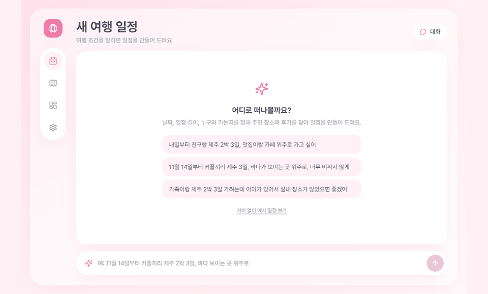

# CLAUDE.md — 여행 일정 플래너 에이전트

이 파일은 이 프로젝트에서 작업하는 Claude가 항상 먼저 읽는 설계서다.
모든 작업은 여기 적힌 구조와 규칙을 따른다. 규칙과 충돌하는 요청이 오면 먼저 나에게 확인한다.

---

## 1. 프로젝트 개요

사용자가 여행 조건(지역, 기간, 동행 유형, 취향, 예산)을 자연어로 말하면,
에이전트가 장소 정보와 후기를 검색(RAG)하고 날씨·동선 도구를 사용해 일정을 만들고,
사용자의 피드백을 받아 일정의 해당 부분만 수정하는 웹 서비스.

- 목적: 일반 AI 엔지니어 포트폴리오
- 보여줄 역량: RAG 파이프라인 설계, LangGraph 상태/분기 설계, 도구 호출, human-in-the-loop, 정량 평가, 배포
- 범위: 지역은 제주 1곳으로 시작 (안정화 후 부산 추가 가능)

## 2. 기술 스택

### 백엔드
- Python 3.11
- LangGraph, LangChain
- FastAPI (+ SSE 스트리밍)
- 벡터DB: Chroma (로컬 영속 저장)
- 키워드 검색: BM25 (rank_bm25) → 하이브리드 검색
- 리랭커: 2단계에서 추가 (모델은 그때 결정)
- LLM / 임베딩: 환경변수로 교체 가능하게 추상화 (`LLM_PROVIDER`, `LLM_MODEL`, `EMBEDDING_MODEL`)
- 관측: LangSmith
- 평가: RAGAS + 자체 정답셋(place_traits.json 기반)

### 프론트엔드
- React 18 + TypeScript + Vite
- 스타일: Tailwind CSS
- 상태 관리: React 기본 훅 (필요해지면 Zustand)
- 지도: 카카오맵 JavaScript API
- 서버 통신: fetch + SSE(EventSource)로 에이전트 진행 상황 스트리밍

### 외부 데이터 / API
- 한국관광공사 TourAPI (공공데이터포털): 장소 기본 정보
- 기상청 단기예보 API (공공데이터포털): 날씨
- 후기: LLM으로 생성한 합성 데이터 (실제 리뷰 크롤링 금지)

## 3. 폴더 구조

```
travel-planner/
├── CLAUDE.md
├── README.md
├── .env.example
├── backend/
│   ├── requirements.txt
│   ├── config.py              # 환경변수 로딩, 설정값
│   ├── llm.py                 # LLM·임베딩 생성 함수 (프로바이더 추상화)
│   ├── ingest/
│   │   ├── fetch_places.py     # TourAPI → data/places.json
│   │   ├── generate_traits.py  # 장소별 숨은 특성 → data/place_traits.json
│   │   ├── generate_reviews.py # 특성 기반 합성 후기 → data/reviews.json
│   │   └── build_index.py      # 청킹·임베딩·Chroma/BM25 인덱스 생성
│   ├── retrieval/
│   │   ├── hybrid.py          # BM25 + 벡터 검색 결합
│   │   └── rerank.py          # 리랭커 (2단계)
│   ├── tools/
│   │   ├── weather.py         # 기상청 API
│   │   └── route.py           # 좌표 기반 이동거리·동선 정렬
│   ├── agent/
│   │   ├── state.py           # PlannerState 정의
│   │   ├── graph.py           # 그래프 조립
│   │   ├── prompts.py         # 노드별 프롬프트 모음
│   │   └── nodes/             # 노드당 파일 하나
│   │       ├── parse_request.py
│   │       ├── ask_clarification.py
│   │       ├── search_places.py
│   │       ├── analyze_reviews.py
│   │       ├── check_weather.py
│   │       ├── build_itinerary.py
│   │       ├── validate_itinerary.py
│   │       └── apply_feedback.py
│   ├── api/
│   │   ├── main.py            # FastAPI 앱
│   │   └── schemas.py         # 요청/응답 Pydantic 모델
│   ├── eval/
│   │   ├── build_testset.py   # place_traits.json → 질문·정답 쌍
│   │   ├── run_eval.py        # 버전별 평가 실행
│   │   └── results/           # 실험 결과 CSV
│   ├── data/                  # 생성 데이터 (원본 API 응답은 git 제외)
│   └── tests/
└── frontend/
    ├── package.json
    ├── vite.config.ts
    └── src/
        ├── api/               # 백엔드 호출, SSE 처리
        ├── components/
        │   ├── layout/            # Sidebar, TopBar, 모바일 TabBar
        │   ├── timeline/          # TimelineView, DayRow, PlaceBlock, TravelGap
        │   ├── chat/              # ChatInput, ChatDrawer, AgentSteps
        │   ├── PlaceDetail.tsx    # 선택한 장소 상세 + 근거 후기
        │   ├── TripSummary.tsx    # 여행 요약 카드
        │   └── MapView.tsx        # 카카오맵 + 동선 표시
        ├── pages/
        │   ├── PlannerPage.tsx
        │   └── DashboardPage.tsx  # 성능 대시보드
        ├── mocks/             # 화면 개발용 더미 데이터
        ├── types/             # 백엔드 스키마와 맞춘 TS 타입
        └── App.tsx
```

## 4. 데이터 설계

### places.json (TourAPI에서 가공)
`id, name, category(관광지/음식점/카페/숙소), address, lat, lng, description, opening_hours(있으면)`

### place_traits.json (평가 정답으로도 사용)
장소마다 먼저 "숨은 특성"을 정하고, 후기는 반드시 이 특성을 반영해 생성한다.
```json
{
  "place_id": "...",
  "pros": ["바다 전망이 좋음", "사진 찍기 좋음"],
  "cons": ["주말 웨이팅 1시간 이상"],
  "good_for": ["커플", "친구"],
  "not_good_for": ["유아 동반"],
  "busy_times": ["주말 오후"],
  "price_level": 1-3,
  "indoor": false
}
```

### reviews.json (합성 후기)
`review_id, place_id, text, rating(1-5), author_type(가족/커플/혼자/친구), season, visit_time, created_at`

생성 규칙:
- 장소당 10~20개
- 약 20%는 짧고 성의 없는 후기, 약 10%는 다른 후기와 상반된 의견
- 특성에 없는 사실을 지어내지 않는다
- README와 UI에 "후기는 합성 데이터"임을 명시한다

### 청킹 / 인덱싱
- 장소 소개: 장소당 1청크 (메타데이터: place_id, category, lat, lng, indoor)
- 후기: 후기 1개 = 1청크 (메타데이터: place_id, rating, author_type, season)
- 메타데이터 필터 검색을 지원한다 (예: author_type=가족, indoor=true)

## 5. LangGraph 설계

### State
```python
class PlannerState(TypedDict):
    messages: list            # 대화 기록
    request: TripRequest | None  # 파싱된 조건: region, start_date, days, companions, preferences, budget
    missing_fields: list[str]    # 부족한 조건
    candidates: list[Place]      # 검색된 후보 장소
    review_summaries: dict[str, ReviewSummary]  # place_id → 장단점 요약 + 근거 후기 id
    weather: dict[str, Weather]  # 날짜 → 날씨
    itinerary: Itinerary | None  # 일자별 일정
    validation_issues: list[str]
    feedback: str | None
    retry_count: int
```

### 흐름
```
START
 → parse_request          조건 추출 (구조화 출력)
 → [조건 충분?]
     아니오 → ask_clarification → (사용자 응답 대기, interrupt) → parse_request
     예 ↓
 → search_places          하이브리드 검색 + 메타데이터 필터
 → analyze_reviews        후보별 후기 요약, 조건과 맞지 않는 장소 제외
 → check_weather          날짜별 날씨 조회 (비 오면 실내 장소 비중 ↑)
 → build_itinerary        일자별 일정 생성 + route 도구로 동선 정렬
 → validate_itinerary     검증: 이동거리 과다, 영업시간 충돌, 조건 위반, 근거 없는 주장
     문제 있음 & retry_count < 2 → build_itinerary
     통과 ↓
 → 사용자에게 제시 (interrupt)
 → [피드백 있음?]
     예 → apply_feedback  (수정 범위 판단: 특정 일자/장소만 교체, 필요 시 search_places부터 재실행)
     아니오 → END
```

### 설계 원칙
- 노드는 하나의 책임만 가진다. 노드끼리 직접 호출하지 않고 State로만 주고받는다.
- 분기 조건 함수는 graph.py에 모아둔다.
- 체크포인터(MemorySaver → 배포 시 SQLite)로 대화 상태를 저장한다. thread_id = 세션 id.
- 사용자 대기 지점은 LangGraph interrupt로 구현한다.
- 일정의 모든 장소 추천에는 근거(장소 정보 또는 후기 id)를 붙인다. 근거 없는 추천은 validate에서 걸러낸다.

## 6. API 설계

| Method | Path | 설명 |
|---|---|---|
| POST | /api/sessions | 새 세션 생성, session_id 반환 |
| POST | /api/sessions/{id}/messages | 사용자 메시지 전송, SSE로 진행 단계·결과 스트리밍 |
| GET | /api/sessions/{id} | 현재 State 요약 (일정, 대화) |
| GET | /api/places/{place_id} | 장소 상세 + 후기 |
| GET | /api/health | 헬스체크 |
| GET | /api/metrics/experiments | 버전별 평가 결과 (eval/results 기반) |
| GET | /api/metrics/runs | 노드별 지연시간·토큰, 요청당 비용·응답시간, 재생성 통계 |

- 노드 실행 시간과 토큰 수는 SSE `step` 이벤트를 보낼 때 함께 기록해 /api/metrics/runs에서 집계한다.

SSE 이벤트 타입: `step`(노드 시작/완료), `question`(되묻기), `itinerary`(일정 결과), `error`, `done`

- 백엔드 Pydantic 스키마와 프론트 `src/types`는 항상 같이 수정한다.

## 7. 프론트엔드 화면

### 7-1. 디자인 방향
- 레퍼런스: 사용자가 공유한 일정 관리 대시보드 이미지 (가로 타임라인 + 알약 모양 블록 + 오른쪽 상세 패널).
  스타일은 참고하되 구조는 여행 일정에 맞게 바꾼다 (아래 7-3).
- 전체 톤: 연한 푸른 회색 배경 위에 흰 카드, 큰 라운드 모서리(rounded-2xl~3xl), 부드럽고 넓은 그림자
- 여백을 넉넉하게, 테두리 선은 최소화하고 그림자와 배경색 차이로 영역을 구분한다
- 폰트: Pretendard (한글), 제목은 굵게(700), 본문은 400~500
- 아이콘: lucide-react

### 7-2. 색상 토큰 (tailwind.config에 등록해서 사용)
| 토큰 | 용도 | 값 |
|---|---|---|
| bg | 페이지 배경 | #EEF2FB |
| surface | 카드 배경 | #FFFFFF |
| primary | 강조, 버튼, 선택 상태 | #4C7DF0 |
| text-main | 본문 | #1F2937 |
| text-sub | 보조 텍스트 | #9CA3AF |
| cat-sight | 관광지 블록 | #22C55E |
| cat-food | 맛집 블록 | #FF8A4C |
| cat-cafe | 카페 블록 | #FFC53D |
| cat-stay | 숙소 블록 | #8B5CF6 |
| cat-activity | 체험/액티비티 블록 | #4FA3F7 |
| changed | 피드백으로 바뀐 블록 강조 | #FF5C7A |

### 7-3. 전체 레이아웃 (데스크톱)
```
┌──────┬───────────────────────────────────────┬──────────────────┐
│      │ 상단바: 여행 제목 · 날짜 · 동행 · [타임라인|지도] 토글 │                  │
│ 사이 ├───────────────────────────────────────┤  PlaceDetail     │
│ 드바 │                                       │  (선택한 장소 상세) │
│      │       TimelineView (메인)              │                  │
│      │                                       ├──────────────────┤
│      │                                       │  TripSummary     │
│      ├───────────────────────────────────────┤  (여행 요약)       │
│      │ 하단 고정: ChatInput (넓은 입력창)          │                  │
└──────┴───────────────────────────────────────┴──────────────────┘
```
- 왼쪽 사이드바(아이콘만): 플래너 / 지도 / 성능 대시보드 / 설정
- ChatDrawer: 대화 내역 + AgentSteps는 왼쪽에서 슬라이드로 열고 닫는 패널. 에이전트 실행 중에는 자동으로 열린다.
- "후기는 합성 데이터입니다" 안내는 PlaceDetail 후기 영역 하단에 고정 표시

### 7-4. TimelineView (핵심 화면)
- 행 = 여행 일차 (1일차, 2일차 …), 가로축 = 시간 08:00~22:00 (30분 단위 격자, 연한 세로선)
- 행 왼쪽 헤더: 일차, 날짜(요일), 날씨 아이콘 + 최고/최저 기온
- 장소 방문 = 알약 모양 블록
  - 길이 = 머무는 시간, 색상 = 카테고리 토큰
  - 왼쪽에 장소 썸네일(원형, TourAPI 이미지 / 없으면 카테고리 아이콘), 가운데 장소 이름, 오른쪽 끝 원형 화살표 버튼
  - 블록이 짧으면 이름만 말줄임 처리하고 hover 시 툴팁
- 블록 사이 빈 공간 = 이동 구간: 가운데에 "🚗 25분" 같은 작은 회색 라벨
- 블록 클릭 → PlaceDetail 갱신 + 블록에 선택 테두리
- 피드백으로 바뀐 블록은 changed 색 테두리와 "수정됨" 배지를 3초간 표시
- 비 오는 날 행은 배경을 아주 연한 파란색으로 처리
- (확장, 기본 완성 후) 블록 드래그로 시간/일차 이동 → 변경 내용을 에이전트 피드백으로 전송

### 7-5. PlaceDetail (오른쪽 위 카드)
- 상단: 방문 시간을 크게 (예: 14:30), 옆에 카테고리 색 세로 막대 + 카테고리명 + 장소 이름
- 추천 이유: 에이전트가 이 장소를 고른 이유 한두 줄
- 근거 후기: 후기 카드 2~3개 (작성자 유형, 별점, 본문 일부)
- 태그: 아이 동반 추천, 실내, 주차 가능 등 원형 칩
- 체크리스트: 예약 필요, 웨이팅 주의 등 (체크 가능, 체크 상태는 localStorage에만 저장)
- 아무것도 선택하지 않았을 때는 "다음 일정" 기준으로 첫 블록을 보여준다

### 7-6. TripSummary (오른쪽 아래 카드)
- 큰 숫자: 방문 장소 수 (예: 12곳)
- 보조 지표: 총 이동시간, 하루 평균 이동시간, 실내 장소 비율
- 진행 바: 조건 충족률 (validate 통과 항목 / 전체 항목)

### 7-7. MapView
- 상단 토글에서 "지도" 선택 시 TimelineView 자리에 표시
- 일차별 색상으로 마커 번호와 동선 선을 그린다
- 타임라인에서 선택한 장소는 지도에서도 강조된다 (선택 상태 공유)

### 7-8. 성능 대시보드 탭 (DashboardPage)
같은 디자인 톤의 카드 그리드로 구성한다. 실시간 계산 없이 백엔드가 제공하는 결과 데이터만 표시한다.
- 실험 비교 카드: v1~v5의 Recall@5, MRR, Faithfulness, 조건 위반율 (막대/선 차트, Recharts)
- 노드별 성능 카드: LangGraph 노드별 평균 지연시간, 평균 토큰 사용량 (가로 막대)
- 요청당 비용·응답시간 카드: 평균값 큰 숫자 + 최근 요청 추이 미니 차트
- 재생성 루프 카드: validate 재생성 비율과 주요 실패 사유 Top 3
- 각 카드 하단에 데이터 출처 표시 (예: eval/results/2026-xx-xx.csv)
- 수치가 없는 항목은 "데이터 없음"으로 표시하고 임의 값을 넣지 않는다

### 7-9. 모바일
- 사이드바 → 하단 탭바 (플래너 / 지도 / 대시보드)
- TimelineView → 일차 탭 + 하루 세로 타임라인 (블록을 세로로 쌓고 사이에 이동시간)
- PlaceDetail → 블록을 누르면 아래에서 올라오는 바텀시트
- TripSummary → 타임라인 상단의 가로 스크롤 요약 칩

### 7-10. 구현 순서와 규칙
1. 디자인 토큰(tailwind.config) + 레이아웃 뼈대
2. 더미 데이터로 TimelineView → PlaceDetail → TripSummary (API 연결 없이 화면부터)
3. ChatInput + ChatDrawer + AgentSteps
4. API·SSE 연결
5. MapView
6. DashboardPage (8단계에서)
- 화면 작업을 요청받으면 레퍼런스 이미지가 첨부되어 있는지 확인하고, 없으면 첨부를 요청한다.
- 더미 데이터는 `src/mocks/`에 두고, 실제 API 타입(`src/types`)과 같은 구조로 만든다.

## 8. 평가 계획

- `place_traits.json`으로 질문-정답 쌍 생성 (예: "아이랑 가기 좋은 실내 장소" → 정답 place_id 집합)
- 검색 지표: Recall@k, MRR
- 생성 지표 (RAGAS): Faithfulness, Answer Relevancy
- 일정 지표: 조건 위반 비율, 하루 평균 이동거리
- 버전별 비교표를 `eval/results/`에 저장하고 README에 정리한다

| 버전 | 구성 |
|---|---|
| v1 | 벡터 검색만 |
| v2 | + 메타데이터 필터 |
| v3 | + 하이브리드(BM25) |
| v4 | + 리랭커 |
| v5 | + validate 재생성 루프 |

## 9. 개발 단계 (순서대로, 한 단계씩)

1. 프로젝트 뼈대: 폴더, requirements.txt, config.py, .env.example
2. 데이터: fetch_places (30곳으로 시작) → generate_traits → generate_reviews (3곳으로 먼저 확인)
3. 인덱싱 + 기본 검색(v1) + 평가셋·평가 스크립트
4. 검색 개선 실험 (v2~v4)
5. LangGraph 노드 구현 (노드별 단독 테스트 후 그래프 조립)
6. FastAPI + SSE
7. React 프론트엔드 (7-10의 순서대로)
8. validate 루프(v5), 최종 평가, 성능 대시보드, README, 배포

각 단계가 끝나면 실행 결과를 나에게 보여주고 멈춘다. 다음 단계는 내가 요청할 때 진행한다.

## 10. 코딩 규칙

### 공통
- 외부 API 스펙(TourAPI, 기상청, 카카오맵)은 추측하지 않는다. 문서를 모르면 나에게 문서를 요청한다.
- API 키는 `.env`에서만 읽고 코드·로그·커밋에 절대 넣지 않는다. 새 키가 필요하면 `.env.example`에 추가한다.
- 요청받은 범위만 수정한다. 관련 없는 파일을 리팩터링하지 않는다.
- 에러 수정 요청 시 원인을 먼저 설명하고 최소 범위로 고친다.
- 새 패키지를 추가하면 requirements.txt / package.json을 갱신하고 이유를 한 줄로 알려준다.

### Python
- 모든 함수에 타입 힌트와 한 줄 docstring
- 데이터 구조는 Pydantic 모델로 정의
- print 대신 logging 사용
- LLM 호출은 `llm.py`를 통해서만 한다 (프로바이더 교체 가능하게)
- 프롬프트 문자열은 `agent/prompts.py`에 모은다
- 노드마다 `tests/`에 최소 1개의 단위 테스트 (LLM은 mock 가능)

### React / TypeScript
- 함수형 컴포넌트 + 훅만 사용
- `any` 사용 금지, API 응답 타입은 `src/types`에 정의
- 컴포넌트 하나당 파일 하나, 200줄 넘으면 분리 제안
- API 호출은 `src/api`에서만 한다

### Git
- 단계마다 커밋하도록 알려준다 (커밋 메시지 제안 포함)
- `data/` 의 원본 API 응답, `.env`, `chroma/` 인덱스는 .gitignore

## 11. 실행 방법 (뼈대 생성 후 갱신)

```bash
# 백엔드
cd backend
pip install -r requirements.txt
cp ../.env.example ../.env   # 키 입력
uvicorn api.main:app --reload

# 프론트엔드
cd frontend
npm install
npm run dev
```

## 12. 환경변수 (.env.example)

```
LLM_PROVIDER=
LLM_MODEL=
EMBEDDING_MODEL=
LLM_API_KEY=
TOUR_API_KEY=
KMA_API_KEY=
VITE_KAKAO_MAP_KEY=
LANGSMITH_API_KEY=
LANGSMITH_PROJECT=travel-planner
```

## 13. README 작성 가이드

README는 면접관이 가장 먼저, 길어야 1~2분 보는 문서다.
"무엇을 만들었고, 어떻게 설계했고, 얼마나 좋아졌는지"가 스크롤 한두 번 안에 보여야 한다.

### 작성 원칙
- 첫 화면(스크롤 전)에 한 줄 소개, 데모 GIF, 데모 링크가 모두 보이게 한다.
- 기능 나열보다 "왜 이렇게 설계했는지"와 "수치로 본 개선"을 강조한다.
- 모든 수치는 `eval/results/`의 실제 실험 결과에서 가져온다. 결과가 없는 수치는 절대 쓰지 않는다.
- 이미지(구조도, 그래프, 스크린샷)는 `docs/` 폴더에 저장하고 상대경로로 넣는다.
- 후기 데이터가 합성 데이터임을 데이터 섹션에 명시한다.
- 단계가 끝날 때마다 해당 섹션을 갱신한다. 마지막에 한꺼번에 쓰지 않는다.

### README 구조 (이 순서를 따른다)

```markdown
# 🧳 (프로젝트 이름)
> 여행 조건을 말하면 장소·후기를 검색하고 날씨와 동선을 고려해
> 일정을 짜고, 피드백에 맞춰 수정하는 LangGraph 기반 Agentic RAG 서비스

[데모 링크] · [시연 영상]



## 핵심 성과
- 검색 Recall@5: v1 OO% → v4 OO% (+OO%p)
- Faithfulness: OO → OO (validate 루프 도입 후)
- 조건 위반 일정 비율: OO% → OO%
(3줄 이내, 가장 인상적인 수치만)

## 주요 기능
- 자연어 조건 파싱 + 부족한 조건 되묻기
- 하이브리드 검색(BM25 + 벡터) + 리랭커
- 후기 기반 장단점 요약과 추천 근거 표시
- 날씨·동선을 반영한 일정 생성
- 피드백 시 일정의 해당 부분만 수정 (human-in-the-loop)

## 아키텍처

(프론트 ↔ FastAPI ↔ LangGraph ↔ 검색/도구 전체 구조 한 장)

## LangGraph 설계

- State 구조 요약
- 노드별 역할 표 (노드 | 역할 | 입력 → 출력)
- 분기 조건 설명 (되묻기, 재생성 루프, 피드백 반영)

## 데이터
- 장소: 한국관광공사 TourAPI (제주 OO곳)
- 후기: LLM 합성 데이터 OO개 (실제 리뷰 아님)
- 생성 방식: 장소별 숨은 특성 → 특성 기반 후기 생성
- 이렇게 만든 이유: 이용약관 준수 + 정답을 아는 평가셋 확보

## 실험 및 평가
| 버전 | 구성 | Recall@5 | MRR | Faithfulness | 조건 위반율 |
|---|---|---|---|---|---|
| v1 | 벡터 검색 | | | | |
| v2 | + 메타데이터 필터 | | | | |
| v3 | + 하이브리드 | | | | |
| v4 | + 리랭커 | | | | |
| v5 | + validate 루프 | | | | |
- 평가셋 구성 방법
- 결과 해석 (어떤 개선이 왜 효과가 있었는지)

## 기술적 고민과 해결
(3~4개, 각각 "문제 → 시도 → 결과" 형식)
예)
### 1. "아이랑 가기 좋은 곳" 검색 정확도가 낮음
- 문제: 벡터 검색만으로는 동행 조건이 잘 반영되지 않음
- 시도: 후기 메타데이터(author_type) 필터 + BM25 결합
- 결과: Recall@5 OO% → OO%

## 기술 스택
| 영역 | 기술 |
|---|---|
| Agent | LangGraph, LangChain |
| Retrieval | Chroma, BM25, Reranker |
| Backend | FastAPI, SSE |
| Frontend | React, TypeScript, Vite, Tailwind, Kakao Map |
| Eval / Ops | RAGAS, LangSmith |

## 실행 방법
(환경변수 설정 → 데이터 생성 → 인덱싱 → 백엔드 → 프론트 순서의 명령어)

## 한계 및 개선 방향
- 합성 후기라 실제 리뷰의 다양성을 완전히 반영하지 못함
- 지역이 제주로 한정됨
- (향후 계획 2~3개)

## 폴더 구조
(간단한 트리, 주요 폴더만)
```

### 준비할 시각 자료
- `docs/demo.gif`: 조건 입력 → 에이전트 진행 단계 표시 → 일정·지도 결과 → 피드백으로 수정되는 장면 (30초 이내)
- `docs/architecture.png`: 전체 시스템 구조도
- `docs/graph.png`: LangGraph 그래프 (graph.get_graph().draw_mermaid_png() 활용 가능)
- `docs/eval_chart.png`: 버전별 지표 변화 그래프 (선택)
- LangSmith 트레이스 스크린샷 1장 (선택)

### 단계별 갱신 시점
| 개발 단계 | 갱신할 README 섹션 |
|---|---|
| 1~2단계 | 프로젝트 소개, 데이터, 실행 방법 |
| 3~4단계 | 실험 및 평가 (v1~v4), 기술적 고민 |
| 5~6단계 | LangGraph 설계, 아키텍처 |
| 7단계 | 주요 기능, 데모 GIF |
| 8단계 | 핵심 성과, 실험 표 완성(v5), 한계 및 개선 방향, 데모 링크 |
