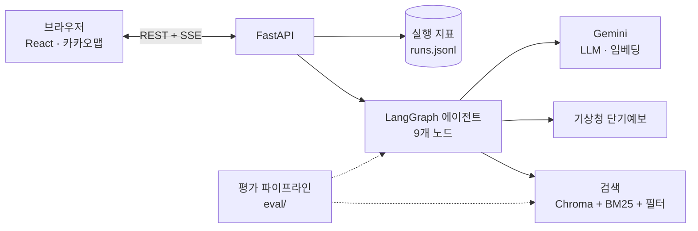

# 🧳 다녀올게 (See you)
> 여행 조건을 말하면 장소·후기를 검색하고 날씨와 동선을 고려해
> 일정을 짜고, 피드백에 맞춰 일정의 해당 부분만 수정하는 LangGraph 기반 Agentic RAG 서비스

[데모 사이트](https://seeyou-production.up.railway.app) · 제주 40곳 · 후기는 합성 데이터 · [백엔드 API 문서](https://seeyou-production.up.railway.app/docs)


## 핵심 성과
모든 수치는 `backend/eval/results/`의 실제 실험 결과이고, 평가셋은 질문 37개(특성형 19 + 키워드형 18), 일정 시나리오는 10개다.
- **검색 Recall@5: v1 77.0% → v3 94.4% (+17.4%p).** 동행·실내·가격 같은 조건이 걸린 특성형 질문만 보면 58.3% → 90.4% (+32.1%p). 메타데이터 필터가 가장 큰 기여를 했다.
- **리랭커(v4)는 v3보다 나아지지 않아(94.3%) 채택하지 않았다.** 로컬 CPU에서 질문당 약 16초가 걸리는 모델이라 비용만 컸다.
- **검증 후 전체 재생성은 위반을 줄이지 못했지만(평균 2.9건 → 2.7건), 위반 항목만 고치는 부분 수리로 바꾸자 크게 줄었다.** 위반이 있는 일정이 80% → 20%, 데이터상 해결할 수 없는 예산 시나리오를 빼면 일정당 위반이 1.44건 → 0.11건이다(전체 재생성은 1.33건 → 1.33건). LLM을 쓰지 않아 응답이 41초 → 18초, 토큰이 26.7k → 18.6k로 줄었다.

## 주요 기능
- 자연어 조건 파싱과 부족한 조건 되묻기 (LangGraph interrupt)
- 하이브리드 검색(BM25 + 벡터) + 메타데이터 필터 (분류·실내 여부·동행 유형)
- 후기 기반 장단점 요약과 **추천 근거 후기 표시** (근거 없는 추천은 검증에서 걸러냄)
- 기상청 단기예보와 이동시간을 반영한 일정 생성, 비 오는 날 실내 우선
- 피드백이 오면 **해당 방문 하나·하루만 교체**하고 바뀐 블록을 표시 (human-in-the-loop)
- 에이전트 진행 단계(노드별 지연·토큰)를 SSE로 실시간 표시, 성능 대시보드

## 아키텍처

서비스는 하나의 컨테이너로 배포한다. FastAPI가 API와 빌드된 React 앱을 함께 서빙해서 도메인이 하나이고 CORS가 필요 없다.

## LangGraph 설계


**State** (`backend/agent/state.py`): `messages`, `request`(지역·날짜·일수·동행·취향·예산), `missing_fields`, `candidates`, `review_summaries`(장단점 + 근거 후기 id), `weather`, `itinerary`, `validation_issues`, `feedback`, `retry_count`. 재검색 여부(`rerun_search`)와 확정 여부(`accepted`)를 위한 플래그 둘을 더했다.

| 노드 | 역할 | 입력 → 출력 |
|---|---|---|
| `parse_request` | 대화에서 조건 추출(구조화 출력), 이전 조건과 병합 | messages → request, missing_fields |
| `ask_clarification` | 부족한 조건을 묻고 사용자 응답 대기(interrupt) | missing_fields → messages |
| `search_places` | 분류별 하이브리드 검색(v3) + 동행 유형 필터 | request → candidates |
| `analyze_reviews` | 후보별 장단점 요약 + 근거 후기 id, 부적합 장소 제외 (LLM 1회) | candidates → review_summaries, candidates |
| `check_weather` | 기상청 단기예보로 날짜별 날씨 조회, 범위 밖·실패면 날씨 없이 진행 | request → weather |
| `build_itinerary` | LLM이 일자·시간대별 장소를 정하고 route 도구로 이동시간·시간표 계산 | candidates, summaries, weather → itinerary |
| `validate_itinerary` | 규칙 검증: 이동 과다, 영업시간, 예산·동행, 식사 누락, 중복, 근거 없는 추천 | itinerary → validation, validation_issues |
| `present_itinerary` | 일정을 사용자에게 제시하고 피드백 대기(interrupt) | itinerary → feedback |
| `apply_feedback` | 수정 범위 판단 후 방문 하나·일차 하나만 교체, 조건 변경이면 재검색 | feedback → itinerary 또는 rerun_search |

**분기 조건** (`backend/agent/graph.py`에 모음)
- 되묻기: 시작일·일수·동행 중 하나라도 비면 `ask_clarification`, 응답 후 다시 `parse_request`
- 검증 루프: 검증 문제가 있고 `retry_count < 2`이면 `repair_itinerary`(부분 수리, 기본)로 고친 뒤 다시 검증하고, 아니면 제시. `VALIDATION_LOOP=regenerate`로 두면 예전처럼 문제 목록을 프롬프트에 넣어 `build_itinerary`를 다시 실행한다(비교 실험용)
- 부분 수리(`agent/repair.py`)는 LLM 없이 규칙으로 실패한 항목만 고친다: 구역·예산·동행·중복·우천 위반은 그 장소만 같은 분류의 적합 후보로 교체, 식사·관광지·방문 수 부족은 동선 중심에서 가까운 후보를 삽입, 이동 과다는 이동이 가장 줄어드는 교체를 시도, 영업시간은 시간만 옮기고 안 되면 교체, 근거는 후기 요약에서 다시 붙인다
- 피드백으로 날짜·일수·동행·예산·구역이 바뀌면(`rebuild`) 처음 조건을 읽던 파서로 피드백을 다시 읽어 합치고 `search_places`부터 다시 한다. 지난 날짜는 받아들이지 않는다
- 피드백: 없으면 종료. 있으면 `apply_feedback` 후 확정이면 종료, 조건 변경이면 `search_places`부터, 부분 수정이면 `validate_itinerary`로
- 부분 수정 뒤에는 재생성 루프를 타지 않는다. 재생성하면 사용자가 요청한 수정이 사라지기 때문이다
- 타임라인 블록을 끌어 다른 시간·일차에 놓으면 "1일차 2번째 방문(장소)을 2일차 14:30로 옮겨줘" 형식의 피드백으로 전송된다. 이 형식은 LLM 없이 규칙(`agent/moving.py`)으로 처리해 호출 비용과 해석 오류가 없고, 이동시간을 다시 계산하며 겹치면 뒤로 밀고 22시를 넘으면 거절한다

**날씨**: 기상청 단기예보(`getVilageFcst`)를 후보 장소가 있는 읍면동 격자(기상청 가이드 엑셀의 제주 43개 읍면동, 서로 다른 격자 23개)로 조회해 일자별 날씨(맑음/흐림/비, 최고·최저기온)를 만든다. 낮 시간대(09~21시)에 강수가 있으면 '비', 아니면 하늘상태로 정한다. 하루치 기온 근거가 부족한 날(예보의 마지막 날은 일부 시각만 제공)은 값을 만들지 않는다.
- 예보는 발표일 기준 +4~5일까지만 제공돼서 그보다 먼 여행은 날씨 없이 일정을 만든다 (화면에는 '날씨 정보 없음').
- 가이드의 서비스 URL(`apihub.kma.go.kr`)은 API허브 전용 키가 필요하고, 공공데이터포털 키는 `apis.data.go.kr` 주소에서 동작했다. 직접 호출로 확인한 사실이며 `tools/weather.py` 주석에 남겼다.

**한계**: 이동시간은 직선거리 기반 근사치다(보정 계수·평균 속도는 가정값). 날씨는 후보 장소가 있는 읍면동 격자별로 병렬 조회하고 일차마다 그날 방문지가 많은 읍면동의 날씨를 붙인다(계획용 날씨는 조회한 곳 중 더 나쁜 쪽을 따른다). 장소의 읍면동은 주소의 읍면동 이름으로 정하고, 도로명 주소처럼 없으면 좌표가 가장 가까운 읍면동의 격자를 쓴다. 일정을 부분 수정하거나 방문을 옮기면 일차 날씨도 새 방문지 기준으로 다시 붙인다.

## API
| Method | Path | 설명 |
|---|---|---|
| POST | `/api/auth/signup` · `/login` · `/logout` · `/delete-account` | 이메일·비밀번호 계정 (게스트로도 사용 가능) |
| GET | `/api/auth/me` | 현재 로그인 사용자 (게스트면 `user: null`) |
| GET·PUT | `/api/settings` | 계정 설정(동행·취향·예산) 조회·저장 |
| GET | `/api/sessions` | 내 대화 기록 목록 |
| POST | `/api/sessions/{id}/claim` | 게스트로 만든 세션을 로그인한 계정으로 옮김 |
| DELETE | `/api/sessions/{id}` | 대화 기록 삭제 |
| POST | `/api/sessions` | 새 세션 생성 (`session_id` = LangGraph `thread_id`) |
| POST | `/api/sessions/{id}/messages` | 메시지 전송. SSE로 진행 단계와 결과를 스트리밍 |
| GET | `/api/sessions/{id}` | 현재 대화·조건·일정 요약 (`awaiting`: 되묻기/피드백 대기 여부) |
| GET | `/api/places/{place_id}` | 장소 상세 + 후기 (후기는 합성 데이터라는 안내 포함) |
| GET | `/api/health` | 헬스체크 |
| GET | `/api/metrics/experiments` | 버전별 평가 결과 (`eval/results/summary.csv` 기반) |
| GET | `/api/metrics/runs` | 노드별 지연·토큰, 요청당 응답시간·비용, 재생성 비율, 주요 실패 사유 |

SSE 이벤트: `step`(노드 시작/완료, 지연·토큰), `question`(되묻기), `itinerary`(일정 결과), `error`, `done`.
사용자 응답을 기다리는 지점(되묻기, 일정 제시)은 LangGraph interrupt로 구현했고, 같은 세션에 다음 메시지를 보내면 그 지점에서 재개된다.
한 세션은 동시에 한 메시지만 처리하며, 처리 중이면 409를 돌려준다.

지표는 실행할 때마다 `backend/data/metrics/runs.jsonl`에 쌓이고(git 제외), 값이 없는 항목은 `null`로 둔다.
비용은 `.env`의 `LLM_PRICE_IN_PER_1M`, `LLM_PRICE_OUT_PER_1M`을 설정했을 때만 계산한다.

## 계정 · 기록 · 맞춤 설정
- **저장소는 PostgreSQL**: 계정, 로그인 세션, 대화 기록 목록, 설정, LangGraph 체크포인트(`AsyncPostgresSaver`)가 모두 한 DB에 들어간다. 서버를 재시작해도 대화를 이어갈 수 있다.
- **인증**: 비밀번호는 Argon2id로 해시하고, 로그인 토큰은 무작위 값의 sha256만 저장한다(쿠키는 httpOnly, SameSite=Lax, 배포에서는 Secure). 없는 이메일에도 같은 시간·같은 문구로 응답하고, 이메일별 로그인 시도 제한(15분 10회)과 IP별 가입 제한을 둔다. 쓰기 요청은 Origin 검사로 CSRF를 막는다.
- **게스트 모드 유지**: 가입 없이 쓸 수 있고, 게스트 세션은 세션 id를 아는 사람만 접근하며 14일 뒤 정리된다. 로그인하면 현재 게스트 세션이 계정으로 옮겨진다. 남의 세션은 404로 응답한다.
- **기록**: 계정별로 대화 목록(제목·일수·동행)이 저장되고, 열면 일정과 대화가 복원된다. 삭제하거나 계정을 지우면 체크포인트까지 함께 삭제된다.
- **맞춤 일정**: 설정(동행·취향·예산)은 로그인하면 서버에, 게스트는 브라우저에 저장된다. `parse_request`가 **사용자가 말하지 않은 항목만** 설정으로 채운다(이번 메시지 > 이전 요청 > 저장 설정, 취향은 합집합). 어떤 설정이 반영됐는지는 일정 안내 문구와 SSE `itinerary.applied_settings`에 표시된다.
- **맞춤 효과 평가** (`eval/run_personalization_eval.py`, 페르소나 4개 × 대조/실험, 날씨 맑음 고정, `gemini-3.1-flash-lite`): 대조군은 동행만 말하고 설정이 없고, 실험군은 동행·취향·예산을 저장 설정으로만 준다. 지표는 확정 일정의 장소 특성으로 계산한다 (LLM 판정 아님).

| 지표 | 대조 | 맞춤 | 맞춤이 더 높은 페르소나 |
|---|---|---|---|
| 취향 일치율 (방문 중 취향 만족) | 0.535 | 0.656 | 4/4 |
| 실내 비율 | 0.828 | 0.745 | 1/4 |
| 예산 초과 방문 비율 | 0.181 | 0.150 | 1/4 (낮을수록 좋음) |
| 검증 위반 건수 (일정당) | 1.0 | 2.5 | 3/4 (낮을수록 좋음) |

  - 취향 일치율은 4개 모두 올랐지만 n=4, 샘플링 한 번이라 크기는 신뢰하기 어렵다. 예산 초과는 조금 줄었을 뿐 일관되지 않다. 실내 비율은 "실내 위주"를 준 페르소나에서만 의미가 있는데 대조군도 이미 0.75라(데이터에 실내 장소가 많다) 차이가 작다 (0.75 → 0.78).
  - 맞춤 일정의 검증 위반이 오히려 늘었다 (1.0 → 2.5). 제약이 늘어서 만족시키기 어려워진 것으로 보이지만 원인은 확인하지 않았다.
  - 결론: 설정이 일정에 반영되는 방향은 확인했지만, 효과가 크다고 말할 수준은 아니다. 결과: `eval/results/personalization_summary.csv`.

## 프론트엔드
React + TypeScript + Vite + Tailwind. 타임라인, 지도(카카오맵), 장소 상세, 여행 요약, 대화 패널로 구성된다.
- **에이전트 연결**: 메시지는 POST라서 `EventSource`를 쓸 수 없어 `fetch`의 스트림 본문을 직접 읽어 SSE를 해석한다 (`src/api/sse.ts`). 청크 경계에서 잘린 이벤트와 한글 바이트 분할도 처리한다.
- **진행 단계**: `step` 이벤트를 받아 노드별 지연·토큰을 대화 패널에 실시간으로 보여 준다. 검증 실패로 일정을 다시 만들면 같은 노드가 반복해서 나타난다.
- **세션**: 세션 id를 `sessionStorage`에 두고, 새로고침하면 `GET /api/sessions/{id}`로 대화와 일정을 복원한다. 서버가 재시작돼 세션이 사라졌으면 조용히 새 세션으로 시작한다.
- **근거 후기**: 장소를 선택하면 `GET /api/places/{id}`로 후기를 가져와(캐시) 일정의 근거 후기 id에 해당하는 것만 보여 준다.
- **지도**: 일정의 장소 좌표로 일차별 마커와 동선을 그리고, 타임라인과 선택 상태를 공유한다.
- **성능 대시보드**: `/api/metrics/experiments`(평가 결과 CSV)와 `/api/metrics/runs`(실행마다 쌓이는 기록)를 그대로 보여 준다. 값이 없는 지표(비용, Faithfulness 등)는 임의 값을 넣지 않고 "데이터 없음"으로 표시하며, 각 카드에 데이터 출처를 적는다.
- 서버 없이 화면만 볼 수 있도록 시작 화면에 "예시 일정 보기"가 있다 (`src/mocks`의 더미 데이터).
- 개발 서버는 `/api`를 `localhost:8000`으로 프록시한다. 배포에서는 `VITE_API_BASE_URL`에 백엔드 주소를 넣는다.

## 데이터
- 장소: 한국관광공사 TourAPI(KorService2) 제주 **40곳** (관광지 22 = 일반 12 + 실내 문화시설 10, 음식점 8, 카페 5, 숙소 5)
- 후기: LLM 합성 데이터 606개 (**실제 리뷰가 아니다**, 장소당 10~19개). 화면의 후기 영역에도 같은 안내를 고정 표시한다.
- 생성 방식: 장소별 숨은 특성(`place_traits.json`)을 먼저 정하고, 그 특성을 반영해 후기를 생성한다.
- 이렇게 만든 이유: 약관을 지키고, **정답을 아는 평가셋**을 만들기 위해서다. (실제 후기는 서비스 약관상 저장·RAG 사용이 어렵다 — 아래 '한계' 참고)
- 실내 문화시설(박물관·미술관·뮤지엄 10곳)을 추가한 이유: 처음 30곳은 관광지 12곳 중 실내가 1곳뿐이라, 비 오는 날 일정에서 관광지가 빠지는 문제가 있었다. 추가 후 관광지 22곳 중 11곳이 실내다.
- 생성 모델은 무료 티어 일일 한도 때문에 섞여 있다: 특성은 `gemini-2.5-flash` 25곳 + `gemini-2.5-flash-lite` 5곳 + `gemini-3.1-flash-lite` 10곳, 후기는 `gemini-2.5-flash-lite` 12곳 + `gemini-3.1-flash-lite` 28곳.
- 인덱스: 장소 1청크 + 후기 1청크(같은 장소 안의 동일 본문 제거) = 645청크, 임베딩 `gemini-embedding-001`, Chroma(cosine). 문서 임베딩은 `backend/data/embeddings.npz`에 캐시해서 배포 서버가 시작할 때 다시 임베딩하지 않는다.

## 실험 및 평가
### 검색 (v1 → v4)
평가셋은 규칙 기반으로 만든 질문 37개다 (`backend/eval/testset.json`).
- **특성형 19개**: `place_traits.json`의 특성 조합(동행 유형, 실내/야외, 가격대, 분류). 정답은 조건을 만족하는 장소 집합.
- **키워드형 18개**: "알파카 만날 수 있는 곳"처럼 고유 표현을 담은 질문. 정답은 소개문·특성에 그 키워드가 있는 장소 (후기 본문은 제외). v3의 BM25 효과를 보려고 v3 평가 후에 추가했다.
- 지표는 장소 단위: Recall@5 = 상위 5개 중 정답 수 / min(정답 수, 5), MRR = 첫 정답 순위의 역수(상위 10개 기준).

| 버전 | 구성 | Recall@5 | MRR | 특성형 R@5 | 키워드형 R@5 |
|---|---|---|---|---|---|
| v1 | 벡터 검색 | 0.770 | 0.841 | 0.583 | 0.968 |
| v2 | + 메타데이터 필터 | 0.935 | 0.941 | 0.904 | 0.968 |
| **v3** | **+ 하이브리드 (BM25, RRF)** | **0.944** | **0.955** | 0.904 | 0.986 |
| v4 | + 리랭커 `bge-reranker-v2-m3` | 0.943 | 0.951 | 0.902 | 0.986 |
| v4 | + 리랭커 `mmarco-mMiniLMv2` | 0.920 | 0.898 | 0.858 | 0.986 |

리랭커 비용 (로컬 CPU, i7-1360P, 후보 30청크 리랭크, 이전 측정):

| 모델 | 파일 크기 | 프로세스 메모리 | 리랭크 지연(중앙값) |
|---|---|---|---|
| `bge-reranker-v2-m3` (568M) | 2.27GB | 약 2.3GB | 약 15.8초 |
| `mmarco-mMiniLMv2-L12-H384` (118M) | 471MB | 약 1.1GB | 약 1.3초 |

**해석**
- **v1 → v2 (특성형 +0.321)**: 벡터 검색만으로는 "카페", "숙소" 같은 분류와 동행 조건이 잘 반영되지 않았다. 분류·실내 여부는 장소 단위로 허용 id를 먼저 구한 뒤 후기 청크까지 거르고, 동행 유형은 후기의 `author_type`으로 거른다.
- **v2 → v3**: BM25(어절 + 문자 바이그램)는 특성형에서는 변화가 없고, 고유 표현이 들어간 키워드형에서 정답을 더 위로 올린다. 이전 30곳·다른 임베딩 기준 실험에서는 특성형에서 오히려 손해였다(특성 표현이 후기의 단어와 우연히 겹침). 즉 BM25의 효과는 질문 유형과 데이터에 따라 달라서, 키워드형 질문을 추가해 확인했다.
- **v3 → v4**: 리랭커는 개선이 없었다. 큰 모델은 키워드형 MRR 1.000까지 올리지만 특성형이 v3보다 약간 낮고 CPU 지연이 16초라 실시간 서비스에 맞지 않는다. 작은 모델은 한국어 품질이 떨어져 오히려 낮아졌다.
- 서비스에는 **v3를 쓴다.**

### 일정 생성 (v5: 검증 루프 — 전체 재생성 vs 부분 수리)
시나리오 10개(동행·일수·취향·예산·날씨 조합)를 실행해, 처음 생성한 일정(루프 없음)과 검증 루프를 마친 최종 일정(루프 적용)을 **같은 실행에서** 비교했다. 날씨는 실험 조건으로 고정했다 (예보는 날마다 달라 재현이 안 되기 때문). 생성 모델은 `gemini-3.1-flash-lite`. 두 방식은 같은 코드에서 `VALIDATION_LOOP`만 바꿔 각각 실행했고, 첫 생성은 LLM이 매번 새로 만들므로 실행마다 "루프 없음" 값이 조금 다르다(괄호는 부분 수리 실행의 값).

| | 루프 없음 (첫 생성) | 전체 재생성 (평균 1.7회) | 부분 수리 |
|---|---|---|---|
| 위반이 1건 이상인 일정 | 90% (80%) | 80% | **20%** |
| 일정당 평균 위반 건수 | 2.9 (2.9) | 2.7 | **1.1** |
| 위반 비율 (검증 항목 기준) | 6.7% (6.8%) | 6.6% | **2.6%** |
| Faithfulness (자체 판정) | 0.945 (0.955) | 0.944 | 0.951 |
| 하루 평균 이동시간 | 98.8분 (102.4분) | 85.5분 | 104.1분 |
| 시나리오별 개선 / 동일 / 악화 | - | 3 / 4 / 3 | **8 / 2 / 0** |
| 평균 응답시간 / 토큰 | - | 41.2초 / 26.7k | **17.9초 / 18.6k** |

데이터상 해결할 수 없는 `family-3d-budget`("최대한 저렴하게")을 뺀 9개 시나리오만 보면 다음과 같다.

| | 첫 생성 | 최종 | 위반이 있는 일정 |
|---|---|---|---|
| 전체 재생성 | 1.33건 | 1.33건 | 89% → 78% |
| 부분 수리 | 1.44건 | **0.11건** | 78% → **11%** |

- 전체 재생성이 줄이지 못한 이유: 위반이 생기면 일정 **전체**를 LLM이 다시 만들어서, 하나를 고치면 다른 하나가 깨졌다(1 → 4건으로 늘어난 시나리오도 있다). 부분 수리는 실패한 항목만 고치므로 악화한 시나리오가 없다.
- 부분 수리가 LLM을 쓰지 않아서 응답이 절반 이하로 줄고 토큰이 약 30% 줄었다. 같은 입력이면 결과도 같다.
- **재현성**: 수리 로직을 보완하기 전에 같은 방식으로 한 번 더 측정했을 때는 위반이 있는 일정 90% → 30%, 예산 시나리오 제외 1.44건 → 0.22건이었다. 보완(영업시간 시간대 변경, 악화되는 수리 거부)은 그때 남은 영업시간 위반 2건을 겨냥한 것이고, 이번 측정에서는 예산 시나리오 밖의 영업시간 위반이 남지 않았다. 다만 두 측정은 LLM이 새로 만든 서로 다른 일정이라 이 차이를 보완의 효과로 단정할 수는 없다.
- **남은 한계**
  - 예산 시나리오는 위반이 16건 → 10건으로 줄었을 뿐이고 하루 평균 이동시간은 133분 → 180분으로 늘었다(지난 측정에서도 100분 → 187분). 원인은 데이터다: 가격대 1 이하인 음식점·카페가 0곳이고, 관광지 7곳은 서로 평균 21.6km(최대 39km) 떨어져 있다. 비싼 관광지를 멀리 있는 싼 관광지로 바꾸면 예산 위반은 줄지만 이동이 늘어난다.
  - 예산 시나리오 밖에서 남은 위반은 이동 과다 1건(`friends-3d-food`)이다.
  - 전체 이동시간은 줄이지 못한다(예산 시나리오 제외 99.0분 → 95.6분). 전체 재생성은 이동시간을 줄였지만(93.5분 → 80.4분) 위반은 못 줄였다.
- 한계: n=10이고 LLM 샘플링 편차가 커서 작은 차이는 유의미하다고 보기 어렵다. Faithfulness는 생성과 **같은 모델**이 판정해서 자기 평가 편향이 있다. 추천 이유 1건마다 근거 후기·장소 정보로 뒷받침되는지를 판정하는 자체 구현이며 RAGAS가 아니다 (`backend/eval/faithfulness.py`).

## 기술적 고민과 해결
### 1. "아이랑 가기 좋은 실내 장소" 같은 조건 검색 정확도가 낮음
- 문제: 벡터 검색만으로는 분류·실내·동행 조건이 잘 반영되지 않았다 (특성형 Recall@5 0.583).
- 시도: 후기 청크에는 분류·실내 정보가 없으므로, 먼저 **장소 단위로 허용 id 목록**을 구한 뒤 후기 청크까지 그 id로 거르고, 동행 유형은 후기의 `author_type`으로 거른다.
- 결과: 특성형 Recall@5 0.583 → 0.904.

### 2. 비 오는 날 일정에서 관광지가 통째로 빠짐
- 문제: 기상청 예보를 연결하자 비 오는 날 일정에 식당·카페만 들어갔다. 검증이 `관광지 누락` 11건을 잡았지만 재생성으로도 고쳐지지 않았다.
- 원인 (데이터로 확인): ① 관광지 12곳 중 실내가 1곳뿐 ② 식당·카페는 전부 실내라 "비 오면 실내 우선" 규칙이 식당·카페로 하루를 채움 ③ 재생성이 문제 하나를 다른 문제로 바꿈.
- 해결: TourAPI 문화시설에서 박물관·미술관 10곳을 추가해 실내 관광지를 1곳 → 11곳으로 늘렸다. 프롬프트에는 "비 오는 날에도 관광지는 최소 1곳"을 명시했다.

### 3. 무료 티어 한도 때문에 인덱스를 다시 만들 수 없음
- 문제: 임베딩 무료 티어에 하루 1,000건 한도가 있어, 데이터를 늘린 뒤 인덱스 재구축이 중간에 막혔다.
- 시도: 임베딩을 본문 해시로 디스크에 캐시하고(캐시에 모델명을 기록해 다른 모델의 벡터는 쓰지 않음), 질문 임베딩도 캐시해서 v1~v4 평가가 같은 질문을 한 번만 임베딩하게 했다. 한도가 남은 `gemini-embedding-001`로 교체하고 모든 평가를 다시 측정했다.
- 결과: 배포 서버는 시작할 때 캐시로 인덱스를 만들어 임베딩 호출이 없다.

### 4. 리랭커를 쓸지 판단
- 문제: 리랭커는 보통 품질을 올려 준다고 알려져 있지만, 로컬 CPU 지연이 컸다.
- 시도: 다국어 리랭커 2종을 같은 평가셋과 함께 지연·메모리까지 측정했다.
- 결과: 큰 모델은 v3 대비 개선이 없고(0.943 vs 0.944) 지연이 약 16초, 작은 모델은 품질이 떨어졌다. 서비스에는 채택하지 않고, 근거를 수치로 남겼다.

## 기술 스택
| 영역 | 기술 |
|---|---|
| Agent | LangGraph, LangChain, Gemini (LLM·임베딩, 환경변수로 OpenAI로 교체 가능) |
| Retrieval | Chroma, BM25(rank_bm25), 메타데이터 필터 |
| Backend | FastAPI, SSE(sse-starlette), Pydantic |
| Frontend | React 18, TypeScript, Vite, Tailwind, Recharts, 카카오맵 |
| 외부 API | 한국관광공사 TourAPI, 기상청 단기예보 |
| Eval / Test | 자체 평가셋·평가 스크립트, 자체 LLM 판정, pytest(91), vitest(43) |
| 배포 | Docker, Railway |

## 실행 방법
```bash
cp .env.example .env   # 키 입력 (TOUR_API_KEY, KMA_API_KEY, LLM_*, EMBEDDING_MODEL, VITE_KAKAO_MAP_KEY)
cd backend
pip install -r requirements-dev.txt

# 데이터 생성 (순서대로. 한도에 걸리면 멈췄다가 다시 실행하면 이어서 한다)
python -m ingest.fetch_places
python -m ingest.generate_traits
python -m ingest.generate_reviews

# 인덱싱과 평가
python -m ingest.build_index            # 임베딩 캐시가 있으면 호출 없이 만든다
python -m eval.build_testset
python -m eval.run_eval --version v1    # v1~v4 (v4는 RERANKER_MODEL 환경변수로 모델 지정)
python -m eval.run_itinerary_eval       # 일정 평가(v5). LLM 호출이 약 70회 든다

# API 서버 (http://localhost:8000/docs) — PostgreSQL이 필요하다 (DATABASE_URL)
# 로컬에서는 내장 PostgreSQL을 함께 띄우는 스크립트를 쓰면 된다 (데이터는 ~/.seeyou/pgdata에 유지)
python -m scripts.dev_server --port 8000
# 직접 DB를 쓸 때: DATABASE_URL=postgresql://... uvicorn api.main:app --reload
# (Windows에서 uvicorn을 직접 실행하면 psycopg 비동기와 이벤트 루프가 맞지 않으니 --loop agent.checkpoint:selector_loop_factory 를 붙인다)

# 테스트
python -m pytest tests -q

# 프론트엔드 (새 터미널, http://localhost:5173)
cd ../frontend
npm install
npm run dev
npm test
```
Gemini 무료 티어는 채팅 모델 일일 호출 한도(모델별 상이), 임베딩 분당 100건·일일 1,000건 한도가 있다.

## 배포 (Railway)
`Dockerfile` 하나로 프론트를 빌드하고 백엔드 이미지에 넣어 서비스 1개로 배포한다 (`railway.toml`).
```bash
railway init --name seeyou
railway add --service seeyou
railway add --database postgres      # Postgres 추가
# 환경변수: DATABASE_URL=${{Postgres.DATABASE_URL}}, COOKIE_SECURE=true, LLM_PROVIDER, LLM_MODEL, LLM_API_KEY, EMBEDDING_MODEL, KMA_API_KEY, VITE_KAKAO_MAP_KEY
railway up --service seeyou
```
- 카카오맵 JavaScript 키는 빌드 때 번들에 들어가는 공개 키다. 카카오 디벨로퍼스에서 배포 도메인을 웹 플랫폼으로 등록해야 지도가 뜬다.
- 계정·대화는 Postgres에 저장돼 재배포해도 남는다. 실행 지표(`runs.jsonl`)는 컨테이너 안에 저장돼 재배포하면 사라진다. 유지하려면 Railway 볼륨을 붙이고 `RUNS_LOG_PATH`를 볼륨 경로로 지정한다.

## 한계 및 개선 방향
- **후기는 합성 데이터**라 실제 후기의 다양성을 반영하지 못한다. 실제 후기는 쓸 수 없었다: Google Places API는 장소당 최대 5개만 주고 `place_id` 외 저장·캐시를 금지하며, 네이버 검색 API는 개정 약관이 복사·저장과 AI 입력 활용을 막는다(2차 보도 기준, 원문 미확인). 공공데이터포털의 제주관광공사 '제주 관광지 평점리뷰 감성분석 데이터'는 6개월 단위 평점·긍부정 **집계**라 원문이 아니다. 이 집계로 합성 특성을 검증·보정하는 것이 다음 후보다.
- 부분 수리는 데이터에 없는 조건(가격대 1 이하 음식점·카페)은 고칠 수 없고, 예산 위반을 줄이는 대신 이동이 늘어날 수 있다. 이동 과다는 상한 안으로 맞추는 쪽이지 이동시간 자체를 줄이는 방식이 아니다.
- 데이터상 만족할 수 없는 제약(예: 가격대 1인 식당이 없는데 "최대한 저렴하게")을 사전에 알아채지 못한다.
- 지역이 제주 40곳으로 한정이고, 평가셋(질문 37개, 일정 시나리오 10개)이 작아 작은 차이는 유의미하지 않다.
- 구역(제주시/서귀포시)을 말하면 장소 주소로 검색을 거르고 검증에서도 확인한다. 다만 장소가 40곳뿐이라 구역 안의 음식점·카페·숙소가 2~4곳씩이다. 구역 안의 세부 지역(성산, 중문 등)은 구분하지 않는다.
- 날씨는 읍면동 격자 단위이고(읍면동 안의 미세 차이는 반영하지 않음), 예보가 발표일 기준 +4~5일까지만 제공돼 먼 여행은 날씨 없이 일정을 만든다.
- 계정 기능은 이메일 인증·비밀번호 재설정이 없다 (가입 시 이메일 소유 확인 안 함). 로그인 시도 제한은 서버 메모리라 인스턴스를 늘리면 공유되지 않는다.
- 사용자가 직접 쓰는 후기는 아직 없다. 맞춤 일정 평가는 페르소나 4개, 1회 실행이라 작은 차이는 유의미하지 않다.

## 폴더 구조
```
.
├── Dockerfile · railway.toml        # 배포 (서비스 1개)
├── backend/
│   ├── agent/                       # LangGraph: state, graph, prompts, nodes/(9개)
│   ├── retrieval/                   # vector, hybrid(BM25+RRF), rerank(실험용)
│   ├── ingest/                      # 수집·생성·인덱싱
│   ├── tools/                       # weather(기상청), route(이동시간)
│   ├── api/                         # FastAPI, SSE, 지표 수집
│   ├── eval/                        # 평가셋·검색 평가·일정 평가·Faithfulness, results/
│   ├── data/                        # places, place_traits, reviews, embeddings.npz
│   └── tests/
├── frontend/src/                    # api(SSE), components, hooks, pages, types
└── docs/                            # 데모 GIF
```
