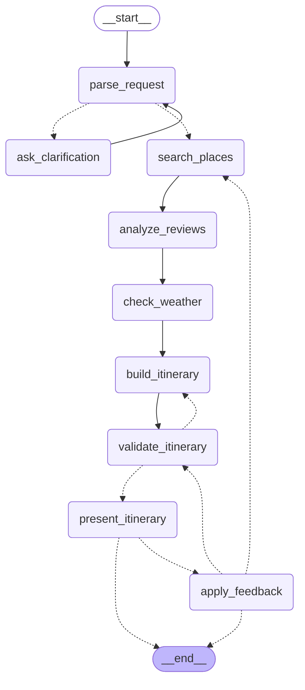

# 🧳 여행 일정 플래너 에이전트
> 여행 조건을 말하면 장소·후기를 검색하고 날씨와 동선을 고려해
> 일정을 짜고, 피드백에 맞춰 수정하는 LangGraph 기반 Agentic RAG 서비스

> 개발 진행 중 (7단계: 프론트엔드 API·SSE 연결과 지도 연동 완료. 남은 것은 성능 대시보드와 배포)

## LangGraph 설계


**State** (`backend/agent/state.py`): `messages`, `request`(지역·날짜·일수·동행·취향·예산), `missing_fields`, `candidates`, `review_summaries`(장단점 + 근거 후기 id), `weather`, `itinerary`, `validation_issues`, `feedback`, `retry_count`. 재검색 여부(`rerun_search`)와 확정 여부(`accepted`)를 위한 플래그 둘을 더했다.

| 노드 | 역할 | 입력 → 출력 |
|---|---|---|
| `parse_request` | 대화에서 조건 추출(구조화 출력), 이전 조건과 병합 | messages → request, missing_fields |
| `ask_clarification` | 부족한 조건을 묻고 사용자 응답 대기(interrupt) | missing_fields → messages |
| `search_places` | 분류별 하이브리드 검색(v3) + 동행 유형 필터 | request → candidates |
| `analyze_reviews` | 후보별 장단점 요약 + 근거 후기 id, 부적합 장소 제외 (LLM 1회) | candidates → review_summaries, candidates |
| `check_weather` | 기상청 단기예보로 날짜별 날씨 조회, 범위 밖·실패면 날씨 없이 진행 | request → weather |
| `build_itinerary` | LLM이 일자·시간대별 장소를 정하고 route 도구로 이동시간·시간표 계산 | candidates, summaries, weather → itinerary |
| `validate_itinerary` | 규칙 검증: 이동 과다, 영업시간, 예산·동행, 식사 누락, 중복, 근거 없는 추천 | itinerary → validation, validation_issues |
| `present_itinerary` | 일정을 사용자에게 제시하고 피드백 대기(interrupt) | itinerary → feedback |
| `apply_feedback` | 수정 범위 판단 후 방문 하나·일차 하나만 교체, 조건 변경이면 재검색 | feedback → itinerary 또는 rerun_search |

**분기 조건** (`backend/agent/graph.py`에 모음)
- 되묻기: 시작일·일수·동행 중 하나라도 비면 `ask_clarification`, 응답 후 다시 `parse_request`
- 재생성 루프: 검증 문제가 있고 `retry_count < 2`이면 문제 목록을 프롬프트에 넣어 `build_itinerary` 재실행, 아니면 제시
- 피드백: 없으면 종료. 있으면 `apply_feedback` 후 확정이면 종료, 조건 변경이면 `search_places`부터, 부분 수정이면 `validate_itinerary`로
- 부분 수정 뒤에는 재생성 루프를 타지 않는다. 재생성하면 사용자가 요청한 수정이 사라지기 때문이다

**날씨**: 기상청 단기예보(`getVilageFcst`)를 제주시 격자(53, 38)로 조회해 일자별 날씨(맑음/흐림/비, 최고·최저기온)를 만든다. 낮 시간대(09~21시)에 강수가 있으면 '비', 아니면 하늘상태로 정한다. 하루치 기온 근거가 부족한 날(예보의 마지막 날은 일부 시각만 제공)은 값을 만들지 않는다.
- 예보는 발표일 기준 +4~5일까지만 제공돼서 그보다 먼 여행은 날씨 없이 일정을 만든다 (화면에는 '날씨 정보 없음').
- 가이드의 서비스 URL(`apihub.kma.go.kr`)은 API허브 전용 키가 필요하고, 공공데이터포털 키는 `apis.data.go.kr` 주소에서 동작했다. 직접 호출로 확인한 사실이며 `tools/weather.py` 주석에 남겼다.

**한계**: 이동시간은 직선거리 기반 근사치다(보정 계수·평균 속도는 가정값). 날씨는 제주시 한 지점 기준이라 서귀포 등 지역 차이는 반영하지 않는다.

## API
| Method | Path | 설명 |
|---|---|---|
| POST | `/api/sessions` | 새 세션 생성 (`session_id` = LangGraph `thread_id`) |
| POST | `/api/sessions/{id}/messages` | 메시지 전송. SSE로 진행 단계와 결과를 스트리밍 |
| GET | `/api/sessions/{id}` | 현재 대화·조건·일정 요약 (`awaiting`: 되묻기/피드백 대기 여부) |
| GET | `/api/places/{place_id}` | 장소 상세 + 후기 (후기는 합성 데이터라는 안내 포함) |
| GET | `/api/health` | 헬스체크 |
| GET | `/api/metrics/experiments` | 버전별 평가 결과 (`eval/results/summary.csv` 기반) |
| GET | `/api/metrics/runs` | 노드별 지연·토큰, 요청당 응답시간·비용, 재생성 비율, 주요 실패 사유 |

SSE 이벤트: `step`(노드 시작/완료, 지연·토큰), `question`(되묻기), `itinerary`(일정 결과), `error`, `done`.
사용자 응답을 기다리는 지점(되묻기, 일정 제시)은 LangGraph interrupt로 구현했고, 같은 세션에 다음 메시지를 보내면 그 지점에서 재개된다.
한 세션은 동시에 한 메시지만 처리하며, 처리 중이면 409를 돌려준다.

지표는 실행할 때마다 `backend/data/metrics/runs.jsonl`에 쌓이고(git 제외), 값이 없는 항목은 `null`로 둔다.
비용은 `.env`의 `LLM_PRICE_IN_PER_1M`, `LLM_PRICE_OUT_PER_1M`을 설정했을 때만 계산한다.

## 프론트엔드
React + TypeScript + Vite + Tailwind. 타임라인, 지도(카카오맵), 장소 상세, 여행 요약, 대화 패널로 구성된다.
- **에이전트 연결**: 메시지는 POST라서 `EventSource`를 쓸 수 없어 `fetch`의 스트림 본문을 직접 읽어 SSE를 해석한다 (`src/api/sse.ts`). 청크 경계에서 잘린 이벤트와 한글 바이트 분할도 처리한다.
- **진행 단계**: `step` 이벤트를 받아 노드별 지연·토큰을 대화 패널에 실시간으로 보여 준다. 검증 실패로 일정을 다시 만들면 같은 노드가 반복해서 나타난다.
- **세션**: 세션 id를 `sessionStorage`에 두고, 새로고침하면 `GET /api/sessions/{id}`로 대화와 일정을 복원한다. 서버가 재시작돼 세션이 사라졌으면 조용히 새 세션으로 시작한다.
- **근거 후기**: 장소를 선택하면 `GET /api/places/{id}`로 후기를 가져와(캐시) 일정의 근거 후기 id에 해당하는 것만 보여 준다.
- **지도**: 일정의 장소 좌표로 일차별 마커와 동선을 그리고, 타임라인과 선택 상태를 공유한다.
- 서버 없이 화면만 볼 수 있도록 시작 화면에 "예시 일정 보기"가 있다 (`src/mocks`의 더미 데이터).
- 개발 서버는 `/api`를 `localhost:8000`으로 프록시한다. 배포에서는 `VITE_API_BASE_URL`에 백엔드 주소를 넣는다.

## 데이터
- 장소: 한국관광공사 TourAPI(KorService2) 제주 30곳 (관광지 12, 음식점 8, 카페 5, 숙소 5)
- 후기: LLM 합성 데이터 453개 (**실제 리뷰 아님**, 장소당 10~19개)
- 생성 방식: 장소별 숨은 특성(`place_traits.json`) → 특성 기반 후기 생성
- 이렇게 만든 이유: 이용약관 준수 + 정답을 아는 평가셋 확보
- 생성 모델: 특성 25곳은 `gemini-2.5-flash`, 5곳은 `gemini-2.5-flash-lite`. 후기 12곳은 `gemini-2.5-flash-lite`, 18곳은 `gemini-3.1-flash-lite` (무료 티어 일일 한도 때문에 모델이 섞여 있음)
- 인덱스: 장소 1청크 + 후기 1청크(같은 장소 안의 동일 본문 제거) = 482청크, 임베딩 `gemini-embedding-2`, Chroma(cosine)

## 실험 및 평가
평가셋은 규칙 기반으로 만든 질문 39개다 (`backend/eval/testset.json`).
- **특성형 21개**: `place_traits.json`의 특성 조합(동행 유형, 실내/야외, 가격대, 분류). 정답은 특성 조건을 만족하는 장소 집합.
- **키워드형 18개**: "알파카 만날 수 있는 곳"처럼 고유 표현을 담은 질문. 정답은 장소 소개문·특성에 그 키워드가 있는 장소 (후기 본문은 제외). v3의 BM25 효과를 보려고 v3 평가 후에 추가했다.
- 지표는 장소 단위로 계산한다.
- Recall@5 = 상위 5개 중 정답 수 / min(정답 수, 5)
- MRR = 첫 정답 순위의 역수 (상위 10개 기준)

| 버전 | 구성 | Recall@5 | MRR | Faithfulness | 조건 위반율 |
|---|---|---|---|---|---|
| v1 | 벡터 검색 | 0.800 | 0.893 | - | - |
| v2 | + 메타데이터 필터 | 0.931 | 0.940 | - | - |
| v3 | + 하이브리드 | 0.915 | 0.933 | - | - |
| v4 | + 리랭커 (`bge-reranker-v2-m3`) | 0.936 | 0.966 | - | - |
| v4 | + 리랭커 (`mmarco-mMiniLMv2`) | 0.919 | 0.908 | - | - |
| v5 | + validate 루프 | | | | |

위 표는 질문 39개 전체 평균이고, 질문 유형별 결과는 다음과 같다 (Recall@5 / MRR).

| 버전 | 특성형 (21개) | 키워드형 (18개) |
|---|---|---|
| v1 | 0.656 / 0.889 | 0.968 / 0.898 |
| v2 | 0.900 / 0.976 | 0.968 / 0.898 |
| v3 | 0.870 / 0.898 | 0.968 / 0.972 |
| v4 `bge-reranker-v2-m3` | 0.908 / 0.937 | 0.968 / 1.000 |
| v4 `mmarco-mMiniLMv2` | 0.878 / 0.861 | 0.968 / 0.963 |

리랭커 모델별 비용 (로컬 CPU 측정: i7-1360P 12코어, 후보 30청크 리랭크):

| 모델 | 파일 크기 | 프로세스 메모리 | 리랭크 지연 (중앙값) |
|---|---|---|---|
| `bge-reranker-v2-m3` (568M) | 2.27GB | 약 2.3GB | 약 15.8초 |
| `mmarco-mMiniLMv2-L12-H384` (118M) | 471MB | 약 1.1GB | 약 1.3초 |

질문별 결과는 `backend/eval/results/`의 CSV에 있다.

### 결과 해석
- **v1 → v2 (특성형 +0.244)**: 벡터 검색만으로는 "카페", "숙소" 같은 분류와 동행 조건이 잘 반영되지 않았다. 분류·실내 여부는 장소 단위로 허용 id를 먼저 구한 뒤 후기 청크까지 거르고, 동행 유형은 후기의 `author_type`으로 거른다. 이 평가에서 가장 큰 개선이다.
- **v2 → v3**: BM25(어절 + 문자 바이그램, RRF 결합)는 특성형에서 오히려 낮아졌다(-0.030). "혼자서 가기 좋은", "가격 부담 없는" 같은 특성 표현이 후기 본문의 단어와 우연히 겹치는 경우가 있었다. 반면 키워드형에서는 Recall은 그대로(벡터가 이미 0.968)이고 MRR이 0.898 → 0.972로 올라, 정답을 더 위로 올리는 효과가 확인됐다.
- **v3 → v4**: `bge-reranker-v2-m3`는 전체 MRR을 0.933 → 0.966으로 올리고 키워드형 MRR 1.000에 도달했다. 그러나 특성형 Recall@5는 0.870 → 0.908로 v2(0.900) 수준이고 MRR은 v2(0.976)보다 낮다. 작은 `mmarco-mMiniLMv2`는 특성형 MRR이 0.861로 v2보다 낮았다.
- **결론**: 이 평가셋에서는 메타데이터 필터(v2)가 품질 대비 비용이 가장 좋다. 리랭커는 키워드형 질문의 순위를 다듬는 데 도움이 되지만, 큰 모델은 CPU 지연(약 16초)이 실시간 서비스에 맞지 않고 작은 모델은 품질이 이득을 상쇄한다.
- **한계**: 질문 39개의 작은 평가셋이라 0.03 안팎의 차이는 유의미하다고 보기 어렵다. v2의 필터는 평가셋에 기록된 값(파싱이 완벽하다고 가정)이어서 상한 수치다. 키워드형 질문은 v3 평가 후에 추가했다.

## 실행 방법
```bash
cp .env.example .env   # 키 입력 (TOUR_API_KEY, LLM_*, EMBEDDING_MODEL)
cd backend
pip install -r requirements.txt

# 데이터 생성 (순서대로)
python -m ingest.fetch_places
python -m ingest.generate_traits
python -m ingest.generate_reviews

# 인덱싱과 평가
python -m ingest.build_index
python -m eval.build_testset
python -m eval.run_eval --version v1   # v1~v4 (v4는 RERANKER_MODEL 환경변수로 모델 지정)

# API 서버 (http://localhost:8000/docs)
uvicorn api.main:app --reload

# 테스트
python -m pytest tests -q

# 프론트엔드 (새 터미널, http://localhost:5173)
cd ../frontend
npm install
npm run dev
npm test
```

Gemini 무료 티어는 채팅 모델 일일 20회, 임베딩 분당 100건 한도가 있어서 생성 스크립트는 중단 후 다시 실행하면 이어서 진행한다.
